# HR System Investigation: Business Flow, Rules and Calculations

**ဘာသာစကား / Languages:** [English](#english) · [မြန်မာဘာသာ](#myanmar)

<a id="english"></a>

# English Version

Written for: a software developer learning enterprise HR processes. Code names, statuses and technical terms are kept as they appear in the code.

## 0. Scope and evidence

**This project has no backend.** It is a front-end Angular 22 app. All data and rules live in in-memory "mock services", which [ARCHITECTURE.md](ARCHITECTURE.md) calls the contract a real API should reproduce. There are no API endpoints, stored procedures or database tables. I traced each process as follows:

`Screen (features/*)` → `abstract data contract (core/services/data/*)` → `mock service (mock-services/*)` → `pure calc (core/utilities/*)` → `seed data (mock-data/*)`

State resets on page reload. Sign-in is a **demo simulation** (see README → Authentication): the signed-in user comes from [auth.service.ts](../ui/src/app/core/services/auth.service.ts); roles are not enforced.

**Status labels:** **[I]** Implemented, **[P]** Partially implemented, **[N]** Not implemented, **[?]** Cannot be determined. A *"no code found"* claim means I searched or fully read the relevant services and found nothing.

**Read in full:** the employee, leave, payroll, payroll-setup, attendance (3 files), organization and settings mock services, the three calculators, the core models, the employee form and the app config.

**Not traced in depth:** recruitment internals, the reporting-structure screen, the dashboard and Excel import internals.

---

## 1. System overview

**Purpose:** a demo HRMS ("APEX HRMS") for managing people, working time, leave and monthly pay. [FEATURES.md](FEATURES.md) states that payroll figures are sample data and that permissions are a simulation.

| Area | Modules |
|---|---|
| Core (your five) | Employees, Organization, Attendance, Leave, Payroll |
| Supporting | Recruitment, Settings (users/roles/permissions), Data Exchange (Excel, employees only), Dashboard |

**Real dependency order.** It is not Employee → Organization → Attendance → Leave → Payroll. Organization is the foundation and Employee sits on it. Payroll consumes Leave, Overtime, Holidays and Salary data.

---

## 2. Module analysis

### A. Employee Management

**What and why:** the master record of a person and their employment. Every other module points at an employee ID.

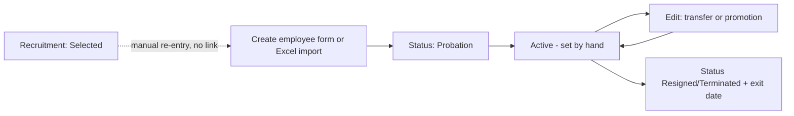

- **Recruitment → Employee is [N].** In the recruitment service, employees appear only to validate the hiring manager and interviewer. Nothing turns a "Selected" candidate into an employee.
- **Registration [I]:** the form requires name, gender, date of birth, marital status, nationality, national ID, work email, phone, address, emergency contact, employee code, type, status, joining date, company, branch, department, position, grade and bank details. Defaults ([employee-form.mapper.ts](../ui/src/app/features/employees/employee-form/employee-form.mapper.ts)): Full-time, status **Probation**, probation end = today + 3 months.
- **Employee code [I]:** `EMP` + highest number + 1, padded to 3 digits (e.g. `EMP061`).
- **Status values:** Active, Probation, On Leave, Suspended, Resigned, Terminated. The first four count as current headcount.
- **History [P]:** only certain changes are logged (below). **Documents [P]:** only file name and metadata are stored.

**Business rules** ([employee-mock.service.ts](../ui/src/app/mock-services/employees/employee-mock.service.ts)):

| Rule | Why | On failure |
|---|---|---|
| Employee code and work email unique (case-insensitive) | Identity | Validation error on the field |
| Not their own manager | Avoids a reporting loop | Error on `managerId` |
| Date of birth not in the future and age ≥ 18 | Labour-age rule | Error |
| Probation end and exit date not before joining date | Date sanity | Error |
| Resigned/Terminated requires an exit date | Needed for payroll cut-off | Error |
| Company → branch → department → section → position chain consistent | Data integrity | Error naming the broken link |
| Inactive org unit or shift can't be newly assigned (existing assignments may stay) | Closed units shouldn't get staff | Error |
| Delete blocked while the employee manages others | Avoids orphaned reports | Conflict |

**History events:** create logs "Joined". A position change logs "Promotion" if the new job-grade ID is higher, otherwise "Transfer". A branch or department change with the same position logs "Transfer". A status change logs "Exit" (Resigned/Terminated) or "Status Change". An employment-type change logs "Contract Change". Demotion has no event type of its own (logged as "Transfer"), and a grade-only change with the same position isn't logged.

**Scenario 1: new joiner.** HR fills the form and saves. This creates the employee and one history row, "Joined as <position>". It does **not** create:

- a salary assignment (the next payroll run warns "no salary assignment and was skipped"),
- a user account,
- a shift (attendance and roster fall back to the first shift in the list),
- a leave balance record (balances are computed on demand).

**Scenario 7: resignation.** HR sets Resigned and an exit date. An "Exit" history row is written. **Nothing else cascades:** no code cancels pending leave, deactivates the user account, reassigns direct reports, or touches shift or salary. Only payroll reacts, via the exit date.

### B. Organization Management

**Structure:** Company → Branch → Department → Section, plus Positions (belonging to a department, with `reportsToPositionId`) and Job Grades (with a min/max salary band).

| Requested | Status |
|---|---|
| Company, Branch, Department, Section, Position, Job Grade | **[I]** |
| Division | **[N]** |
| Team | **[N]** (Section is the closest) |
| Designation | **[P]**: `Position.title` plays this role |
| Reporting relationships | **[P]**: person-level `employee.managerId` and position-level `reportsToPositionId` exist; the Reporting Structure screen was not traced |
| Organization-change workflow or history | **[N]** |

**Rules** ([organization-mock.services.ts](../ui/src/app/mock-services/organization/organization-mock.services.ts)): unique codes (company name too); a department's branch belongs to its company; a position's section belongs to its department and a position can't report to itself; grade max ≥ min; referenced records can't be deleted ("Deactivate it instead").

**How the organization affects other modules:**

- **Employee:** chain-consistency validation. Because a position belongs to one department, **a department transfer forces choosing a new position too**.
- **Salary:** the grade's band restricts the basic salary.
- **Leave:** the grade selects the leave policy (managers get 18 annual days).
- **Attendance/Leave views:** branch and department are filters only, not approval routing.
- **Payroll:** department, position and company names are **snapshotted into the payslip**.
- **Holidays:** looked up by date only (no branch scoping seen).

### C. Attendance Management

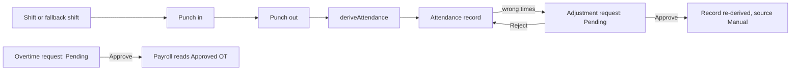

**Daily calculation** ([attendance-calc.ts](../ui/src/app/core/utilities/attendance-calc.ts)):

| Item | Formula |
|---|---|
| Late | `checkIn > start + grace` → `checkIn − start`. Within grace, late is **0**. |
| Worked | `(checkOut − checkIn) − break` |
| Half day | net minutes after break `< 240` (4 hours); worked is then gross minutes |
| Early leave | `end − checkOut` (0 for a half day) |
| Derived overtime | minutes after shift end, only if more than 30 |
| Night shift | end and check-out roll past midnight (+1440) |

**Punch rules:** creates the day's record if missing; blocked on an On Leave day; no double check-in/out; check-out needs a check-in; day-shift check-out must be after check-in. A punch on a Weekend/Holiday is forced to "Present" with a remark (no overtime created).

**Adjustments:** date not in the future; a record must already exist; at least one change; one Pending request per employee and date; only Pending requests editable/deletable/decidable. Approval re-runs `deriveAttendance` with the requested status forced and marks the record `Manual`.

**Overtime request:** 15 minutes to 12 hours; not future; **one entry per employee per date regardless of status**; Pending → Approved/Rejected.

| Feature | Status |
|---|---|
| Check-in/out, hours, late, early, half day, night shift | **[I]** |
| Break time | **[P]**: fixed deduction per shift; no break punches |
| Weekly schedule/roster | **[P]**: read-only view from shift work days, holidays and approved leave |
| Auto-creating daily records or marking Absent | **[?]**: no scheduler found |
| Attendance period approval or lock | **[N]** |

### D. Leave Management

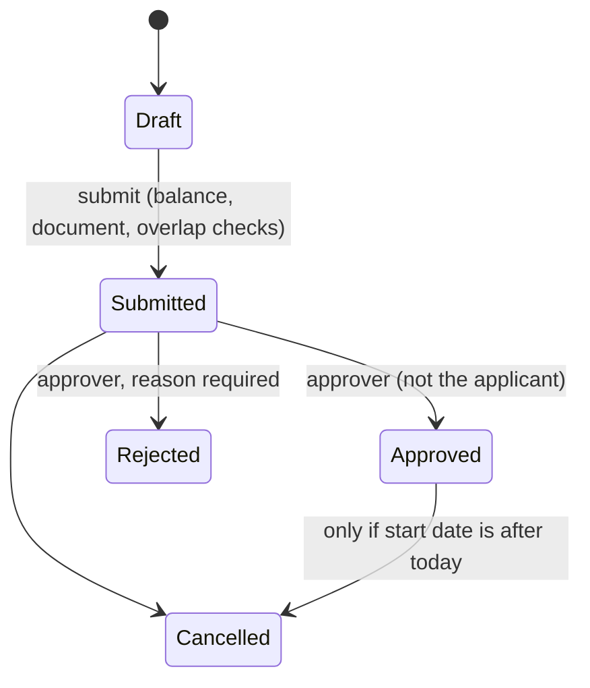

**Entitlement** ([leave-balance.ts](../ui/src/app/core/utilities/leave-balance.ts)):

1. Candidates are active policies for the leave type matching the employee's grade and employment type (null matches everyone).
2. Candidates whose `minServiceMonths` isn't reached are dropped. The most specific wins (grade match = 2, employment-type match = 1; ties go to more days).
3. No policy at all → the type's default days. Policies exist but none eligible → **0**.
4. Monthly accrual = `days × currentMonth / 12`, in half-day steps.

**Balance:** `available = max(0, entitled − Approved − Submitted)`. Submitted days are reserved.

**Application rules:** days = working days excluding weekends and holidays, or 0.5 for a half day (single date only); at least one working day; start ≥ joining date; days ≤ the type's `maxConsecutiveDays`; gender-eligible (Maternity = Female, Paternity = Male); no overlap with Submitted/Approved leave. On submit: a required document must be present and days must be ≤ available.

**Approval:** the **only authority check** is that the applicant can't decide their own request. Rejection needs a reason.

**Effect on attendance:** on approval, existing attendance records for that employee in the range, on or before today, with status Present/Late/Absent/Half Day become **On Leave** (times cleared, leave number in remarks). Weekend/Holiday records are untouched and future days have no records.

| Feature | Status |
|---|---|
| Leave types, policy, accrual, balances, half day, multi-day, cancel | **[I]** |
| Carry-forward | **[P]**: flag and max-days fields only; not applied in balance calculation |
| Encashment | **[N]** |
| Manual balance adjustment | **[N]** (balances are computed, not stored) |
| Manager-based or multi-level approval | **[N]** |

### E. Payroll Management

**Setup [I]:**

- **Components:** Earning or Deduction; method Fixed, PercentOfBasic or PercentOfGross; unique code; value > 0; percentage ≤ 100; can't be deleted while used by a structure.
- **Structures:** at least one component and at least one **Earning**.
- **Assignments:** employee, Active structure, basic and effective-from. Basic must be inside the **job-grade band**; effective-from on or after joining; one assignment per employee per start date; the last assignment can't be deleted.

**Period:** a **calendar month**. Not in the future, one per month, pay date not before the period start. Only Draft can be edited or deleted.

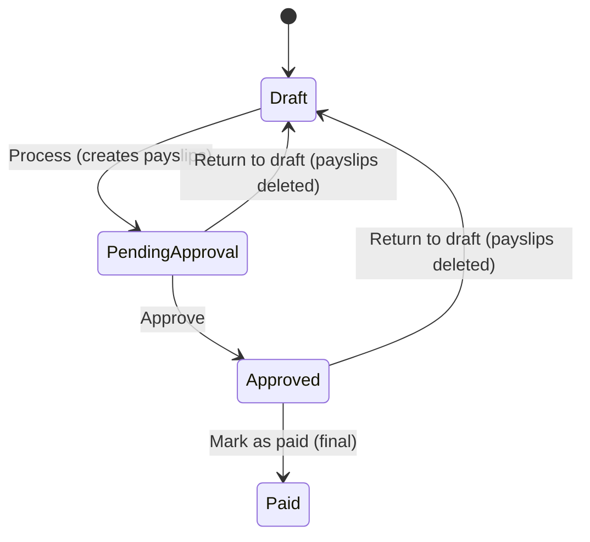

**Process:**

1. Must be Draft.
2. Blocked if any earlier period is Draft or Pending Approval (an earlier Approved period does not block).
3. Working days = days in month − weekends − holidays.
4. Skip employees who joined after the period end or left before the period start.
5. Use the salary assignment effective on the **period end date**; if none, warn and skip.
6. Collect unpaid-leave days and approved overtime minutes.
7. Calculate pay, build payslip snapshots, set status to Pending Approval.

**Not implemented:** real tax/social security **[N]** (sample 5% tax and 2% social only), bonuses **[N]**, a separate "close" step **[N]** (**Paid is the closing state**), payment file/bank integration **[N]**.

---

## 3. End-to-end business flow

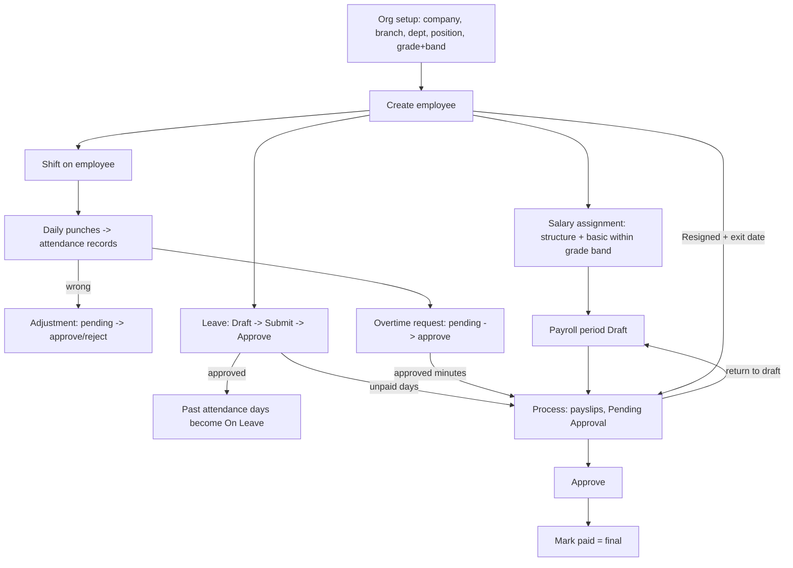

**Key point: attendance records are not an input to payroll.**

---

## 4. Cross-module dependencies

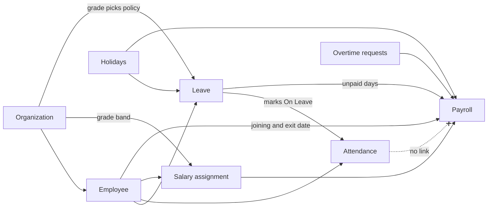

| # | Question | Answer from the code |
|---|---|---|
| 1 | New employee: what else is created? | A history row only. No salary, user, shift or balance record. |
| 2 | Department change | Chain validated (a new position is required); "Transfer" history written. `managerId`, shift and salary untouched. |
| 3 | Shift change | Roster and **future** punches use the new shift. Existing records keep their old `shiftId` and aren't recalculated. |
| 4 | Leave approved → attendance | Past, non-weekend/holiday days become On Leave. Future days have no record yet. |
| 5 | Unpaid leave → payroll | An "Unpaid leave" deduction line is added. |
| 6 | Overtime approved → payroll | An "Overtime pay" earning line at 1.5× the hourly rate. |
| 7 | Resignation | Only payroll reacts, through proration to the exit date. |
| 8 | Branch transfer | Nothing re-points the manager or salary. Future payslips show the new branch/department names. |
| 9 | Attendance edited after payroll | No lock. Payroll doesn't read attendance records at all. |
| 10 | Period closed (Paid) | Only status and `paidOn` change; the period and payslips become immutable. |

**Risk:** if leave or overtime is approved after a period is processed, the payslips stay stale unless the period is returned to Draft. Once Paid, there is no arrears mechanism. Also, leave can still be applied for after an exit date (only the joining date is validated), and payroll ignores employment status, so a Suspended employee is paid normally.

---

## 5. Roles and approval workflows

**Roles exist as data and are enforced nowhere.** There are no route guards beyond the unsaved-changes guard, and a grep for `roles.includes`, `hasPermission` or `canActivate` found no use. [FEATURES.md](FEATURES.md) says: "Nothing is enforced anywhere."

| Role | Intended grants (not enforced) |
|---|---|
| HR Administrator (built-in) | Everything |
| HR Officer | Create/Edit employees; approve attendance and leave; payroll View only |
| Department Manager | Approve attendance and leave; View employees |
| Payroll Officer | Create/Edit/Approve payroll |
| Recruiter | Recruitment only |
| Employee (built-in) | Basic self-service View; create leave |
| Auditor | View only (inactive) |

**Enforced Settings rules:** built-in roles can't be renamed, deleted or deactivated; a role with active users can't be deactivated or deleted; HR Administrator permissions can't be edited; granting any action requires View; a user links to a **current** employee, one user per employee; users can't change their own role or deactivate/delete themselves; there must always be one active administrator.

| Process | Who can approve in code | Levels |
|---|---|---|
| Leave | Anyone except the applicant | Single |
| Attendance adjustment | Anyone, including the requester | Single |
| Overtime | Anyone, including the requester | Single |
| Payroll | Process, Approve and Mark paid can be done by the same person | Single, no segregation of duties |

Approval depending on department, branch or reporting manager: **[N]**. Multi-level approval: **[N]**.

---

## 6. Business rules catalog

| ID | Module | Rule | Location |
|---|---|---|---|
| E-01~E-08 | Employee | Unique code/email; not own manager; age ≥ 18; date order; exit date required; org chain consistent; inactive units not assignable; can't delete a manager of others | employee-mock.service.ts:100-207 |
| E-09 | Employee | Delete removes documents and history only; attendance, leave, salary records remain **[P]** | employee-mock.service.ts:240 |
| E-12 | Employee | Auto Probation → Active **[N]** | none found |
| O-01~O-05 | Org | Unique codes; branch/company, section/department consistency; grade max ≥ min; referenced records can't be deleted | organization-mock.services.ts |
| A-01~A-03 | Attendance | Late, half-day and overtime calculation | attendance-calc.ts |
| A-04~A-05 | Attendance | Punch rules; no punch on an On Leave day | attendance-mock.services.ts:142 |
| A-06~A-08 | Attendance | Adjustment and overtime rules | attendance-workflow-mock.services.ts |
| A-10 | Attendance | Period lock **[N]** | none found |
| L-01~L-09 | Leave | Day counting, max consecutive, gender, no overlap, document, balance, no self-approval, no cancel once started | leave-mock.services.ts |
| L-10 | Leave | Approval rewrites past attendance to On Leave | leave-mock.services.ts:380 |
| L-12 | Leave | Carry-forward applied / encashment **[N]** | none found |
| P-01~P-08 | Payroll | Monthly period, one per month, state transitions, earlier period first, basic within grade band, payslip snapshots | payroll-mock.services.ts |
| P-09 | Payroll | Role-based or segregated approval **[N]** | none found |
| S-01 | Settings | At least one active administrator; no self role change/deactivation | settings-mock.services.ts:164-185 |

---

## 7. Calculation logic

**Attendance** (GEN shift 09:00–18:00, break 60, grace 15):

| Event | Result |
|---|---|
| In 09:10, out 18:00 | 550 ≤ 555 (start + grace) → **Present**, late 0, worked 450 |
| **In 09:30**, out 18:00 | 570 > 555 → **Late 30**, worked 450 |
| Out 19:00 | 60 min after end > 30 → derived OT **60** (paid only if an OT request is approved) |
| In 09:00, out 12:30 | 210 − 60 = 150 < 240 → **Half Day** |

**Leave:**

- Standard annual policy ("after 3 months"): 2 months of service → entitlement **0**; 3 months → 15 days.
- Casual leave (monthly accrual): in November, 6 × 11 / 12 = **5.5** days.
- A manager (grade 6) gets **18** annual days, because the grade policy outranks the default.

**Payroll** ([payroll-calc.ts](../ui/src/app/core/utilities/payroll-calc.ts)):

```
proration   = daysEmployed / calendarDaysInPeriod        (joiners/leavers; exit day inclusive)
basic       = basicSalary × proration
earning     = Fixed: value × proration | % of basic: basic × value / 100
hourly      = basicSalary / (workingDays × 8)             (full basic, not prorated)
overtimePay = overtimeHours × hourly × 1.5
gross       = basic + earnings + overtimePay
deduction   = Fixed: value × proration | % of basic | % of gross
unpaid      = unpaidDays × (basicSalary / workingDays)    (full basic, not prorated)
net         = gross − (deductions + unpaid)
```

**Worked example:** basic 3,000; 22 working days; housing 10% of basic; transport fixed 50; sample tax 5% of gross; 2 unpaid days; 2 approved OT hours.

- Earnings: 300 + 50 = 350
- Hourly = 3000 / 176 = 17.045, so OT = 2 × 17.045 × 1.5 = **51.14**
- Gross = 3000 + 350 + 51.14 = **3,401.14**
- Tax = 5% × 3,401.14 = 170.06
- Unpaid = 2 × (3000 / 22) = 272.73
- Net = 3,401.14 − 170.06 − 272.73 = **2,958.35**

**Quirks:**

- Unpaid leave is a deduction, not a gross reduction, so % of gross deductions (tax) are still calculated on the full gross.
- Overtime and unpaid leave use the full basic (no proration) and ignore allowances.
- A mid-month salary revision isn't split: the assignment in force at month end applies to the whole month.
- Late and absent days don't affect pay. Only unpaid-leave applications do.

---

## 8. Real-world scenarios

**S2: 30 minutes late.** GEN shift, 15 min grace; punch in at 09:30. `deriveAttendance` returns Late with 30 late minutes and remark "Late arrival". No approval involved. Appears in the overview late list. Payroll unaffected.

**S3: three days of annual leave.**
1. Create a Draft. Days are computed excluding the weekend; max consecutive days (10), overlap and joining date are validated.
2. Submit. Document and balance are checked; three days are reserved as pending.
3. A *different* user approves. Pending becomes taken, and past days become On Leave. If the applicant tries to approve: "You cannot decide your own leave request."

**S4: unpaid leave.** Same flow with leave type `UL` (not paid). After approval, the next payroll run for that period adds an "Unpaid leave: n day(s) × daily rate" deduction. A later cancellation changes the balance but not existing payslips.

**S5: two hours of overtime.** A request is created (start/end time, Pending), approved, then added as "Overtime pay" when the period is processed. It must be requested separately from the punch-derived overtime. Approving after processing requires Return to Draft and reprocessing.

**S6: department transfer.** HR edits the department and **must also pick a position** in the new department. A "Transfer" history entry is written. Manager, shift and salary stay. Leave approval isn't affected. Future payslips show the new department.

**S7: resignation mid-period.** Status Resigned, exit date the 20th. An "Exit" history entry is written. That month's payroll is prorated 20/30. User account, pending leave and subordinates are untouched.

---

## 9. Missing or incomplete

**Not implemented (strong evidence):**
- Recruitment → employee conversion.
- Probation auto-confirmation, notice period, final settlement or exit clearance.
- Leave encashment; carry-forward actually applied.
- Manager/department-based approval, multi-level approval, role enforcement.
- Division and Team entities.
- Real tax/statutory contributions, bonuses.
- Attendance period lock; protection against changes after payroll; arrears.

**Partial or inconsistent:**
- **Orphans on delete:** deleting an employee cleans documents and history only.
- **Duplicate overtime rule** ignores status, so a Rejected request blocks a corrected re-request for that date.
- **Two overtime concepts:** punch-derived overtime is shown but never paid; only approved overtime requests are paid.
- **Leave balance year:** `availableDays` always uses the current calendar year and today's date, even for leave in another year.
- **Cancelled leave** doesn't revert the "On Leave" attendance rewrite.
- **Leave for exited employees** is possible (only the joining date is validated).
- **Payroll ignores employment status**; only joining/exit dates matter.
- **Payroll gating:** the "earlier period" check excludes Approved periods, slightly different from the docs' "must be finished first".
- **Grade changes** aren't re-checked against the existing basic salary or logged on their own.
- **National ID** has no uniqueness check (only code and work email do).
- **General Settings** (timezone, currency, fiscal year) aren't read by other screens.

**Risks:** no segregation of duties on payroll; stale payslips after later approvals; a Paid period can't be corrected in-app; everything resets on reload; no audit trail beyond employee history and the activity feed.

---

## 10. Final business understanding

1. **Set up** the organization (company → branch → department → section → positions) and job grades with salary bands. Define leave types and policies, shifts, holidays, salary components and structures.
2. **Hire.** Recruitment finds the person, but employee creation is a *manual, separate* step. HR registers the employee as Probation, then separately assigns a salary (validated against the grade band) and a shift.
3. **Work.** Daily punches create attendance records through the shift rules. Errors are fixed through approved adjustments; extra hours are paid only through separately approved overtime requests.
4. **Leave.** Policy and grade decide the entitlement. Applications are validated, checked against the balance and approved by someone other than the applicant. Approval rewrites past attendance as On Leave.
5. **Pay.** Each month HR creates a period and processes it. Payroll takes salary, structure, joining/exit dates, approved unpaid leave, approved overtime and holidays, and produces payslip snapshots that are approved and marked paid. Paid is final.
6. **Separate.** Setting Resigned/Terminated with an exit date writes an "Exit" history entry. The only automatic consequence is payroll proration. There is no settlement, leave payout or cleanup.

**Three things to remember:**
- The real connections are **Leave → Attendance**, **Leave/Overtime → Payroll** and **Org → Employee/Salary/Leave policy**.
- Attendance is an independent record, not an input to pay.
- Roles and approval authority are currently enforced nowhere.

---

<a id="myanmar"></a>

# မြန်မာဘာသာ (Myanmar Version)


ရည်ရွယ်ထားသူ: HR လုပ်ငန်းစဉ်များကို လေ့လာနေသော software developer။ ကုဒ်အမည်များ၊ status များနှင့် နည်းပညာဝေါဟာရများကို အင်္ဂလိပ်လိုပင် ထားထားပါသည်။

## ၀။ အရေးအကြီးဆုံး အချက်

ဒီ project မှာ **backend မရှိပါ**။ Angular front-end app တစ်ခုသာဖြစ်ပြီး data နှင့် business rule အားလုံးသည် memory ထဲက "mock services" များထဲတွင် ရှိပါသည်။ ထို့ကြောင့် API endpoint၊ stored procedure၊ database table များ မရှိပါ။ အောက်ပါလမ်းကြောင်းအတိုင်း ခြေရာခံခဲ့သည်။

`Screen (features/*)` → `data contract (core/services/data/*)` → `mock service (mock-services/*)` → `calculator (core/utilities/*)` → `seed data (mock-data/*)`

Page ကို reload လုပ်ရင် data အားလုံး ပြန်ကျသွားပါမည်။ Login လည်း မရှိပါ။ [current-user.service.ts](../ui/src/app/core/services/current-user.service.ts) မှာ "Su Myat Noe" (HR Administrator) ကို ပုံသေထားပြီး ဘာလုပ်လုပ် သူ့အနေနဲ့ပဲ လုပ်ပါသည်။

**Status အမှတ်အသား:** **[I]** အကောင်အထည်ပေါ်ပြီး၊ **[P]** တစ်စိတ်တစ်ပိုင်း၊ **[N]** မရှိသေး၊ **[?]** သေချာမသိနိုင်။

ဖတ်ထားပြီး ခြေရာခံထားသည်များမှာ employee၊ leave၊ payroll၊ attendance၊ organization၊ settings mock services များနှင့် calculator ၃ ခု ဖြစ်သည်။ Recruitment အတွင်းပိုင်း၊ Reporting Structure screen၊ Dashboard နှင့် Excel import ကိုမူ အနက်ရှိုင်းရှိုင်း မခြေရာခံထားပါ။

---

## ၁။ စနစ်အကျဉ်းချုပ်

ဒါက "APEX HRMS" ဆိုတဲ့ demo စနစ်ဖြစ်ပြီး လူ၊ အလုပ်ချိန်၊ ခွင့်နှင့် လစာကို စီမံသည်။ Payroll ကိန်းဂဏန်းတွေက နမူနာသာဖြစ်ပြီး permission တွေက simulation သာ ဖြစ်သည်။

| အပိုင်း | Module |
|---|---|
| အဓိက ၅ ခု | Employees, Organization, Attendance, Leave, Payroll |
| ထောက်ခံ | Recruitment, Settings (user/role/permission), Excel import/export (employee သာ), Dashboard |

**တကယ့် dependency အစီအစဉ်:** Employee → Organization → Attendance → Leave → Payroll အတိုင်း မဟုတ်ပါ။ Organization က အခြေခံ ဖြစ်ပြီး Employee က ၎င်းပေါ်မှာ တည်ရှိသည်။ Payroll က Leave၊ Overtime၊ Holiday၊ Salary data တို့ကို ယူသုံးသည်။

---

## ၂။ Module တစ်ခုချင်း

### က။ Employee Management

**ဘာလဲ၊ ဘာကြောင့်လိုသလဲ:** လူတစ်ယောက်ရဲ့ အချက်အလက်နှင့် အလုပ်အကိုင်အချက်အလက် အဓိကမှတ်တမ်း ဖြစ်သည်။ တခြား module အားလုံးက employee ID ကို ညွှန်းသုံးကြသည်။

**Lifecycle (တကယ်ရှိတဲ့အတိုင်း):**

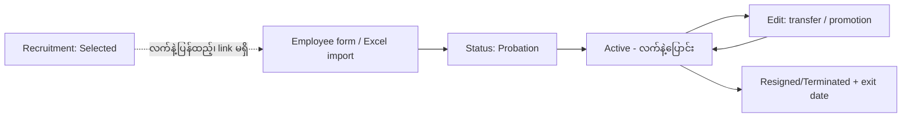

- **Recruitment → Employee ပြောင်းတာ [N]:** Selected ဖြစ်တဲ့ candidate ကို employee အဖြစ် အလိုအလျောက် ဖန်တီးတဲ့ code မရှိပါ။
- **Registration [I]:** နာမည်၊ ကျား/မ၊ မွေးနေ့၊ နိုင်ငံသား၊ NRC၊ email၊ ဖုန်း၊ လိပ်စာ၊ အရေးပေါ်ဆက်သွယ်ရန်၊ employee code၊ type၊ status၊ ဝင်ရောက်ရက်၊ company/branch/department/position/grade နှင့် bank အချက်အလက်တို့ ဖြည့်ရသည်။ Default က Full-time၊ status **Probation**၊ probation ကုန်ရက် = ဒီနေ့ + ၃ လ။
- **Employee code [I]:** `EMP` + အကြီးဆုံးနံပါတ် + ၁ (ဥပမာ `EMP061`)။
- **Status:** Active, Probation, On Leave, Suspended, Resigned, Terminated။ ပထမ ၄ ခုက လက်ရှိ headcount ထဲပါသည်။

**Business rules ([employee-mock.service.ts](../ui/src/app/mock-services/employees/employee-mock.service.ts)):**

| Rule | အကြောင်းရင်း | မကိုက်ရင် |
|---|---|---|
| Employee code နှင့် work email ထပ်လို့မရ | လူကို တိတိကျကျ ခွဲရန် | Field မှာ error |
| ကိုယ့်ကိုယ်ကို manager မလုပ်ရ | reporting loop မဖြစ်ရန် | Error |
| မွေးနေ့ အနာဂတ်မဖြစ်ရ၊ အသက် ၁၈ နှစ်ပြည့် | အသက်ကန့်သတ်ချက် | Error |
| Probation ကုန်ရက်၊ exit date သည် joining date မတိုင်မီ မဖြစ်ရ | ရက်စွဲမှန်ကန်ရန် | Error |
| Resigned/Terminated ဆိုရင် exit date လိုသည် | Payroll cut-off အတွက် | Error |
| Company → branch → department → section → position ကွင်းဆက် ကိုက်ညီရမည် | data မှန်ကန်ရန် | ကျိုးနေတဲ့ link ကို ပြပြီး error |
| Inactive ဖြစ်တဲ့ unit/shift ကို အသစ်မသတ်မှတ်ရ | ပိတ်ထားတဲ့ unit မှာ လူမထည့်ရန် | Error |
| လက်အောက်ငယ်သား ရှိသူကို delete မရ | Orphan မဖြစ်ရန် | Conflict |

**History မှတ်တမ်း:** ဖန်တီးရင် "Joined"၊ position ပြောင်းပြီး grade ID မြင့်လာရင် "Promotion"၊ မမြင့်ရင် "Transfer"၊ branch/department ပြောင်းရင် "Transfer"၊ status ပြောင်းရင် "Exit" သို့မဟုတ် "Status Change"၊ type ပြောင်းရင် "Contract Change"။ Demotion အတွက် သီးသန့် event မရှိဘဲ "Transfer" အဖြစ်ပဲ မှတ်ပါသည်။ Grade ကိုသာ ပြောင်းပြီး position အတူတူဆိုရင် မှတ်မထားပါ။

**ဥပမာ - ၁။ ဝန်ထမ်းအသစ်:** HR က form ဖြည့်ပြီး save လိုက်ရင် employee နှင့် history တစ်ကြောင်း ("Joined as ...") သာ ဖြစ်ပေါ်သည်။ အောက်ပါတို့ကို **အလိုအလျောက် မဖန်တီးပါ**။

- Salary assignment မရှိတဲ့အတွက် payroll run မှာ "no salary assignment and was skipped" ဆိုတဲ့ warning ထွက်ပြီး ကျော်သွားမည်။
- User account မရှိ။
- Shift မရှိရင် စာရင်းထဲက ပထမဆုံး shift ကို fallback အဖြစ် သုံးသည်။
- Leave balance ကို သိမ်းထားခြင်းမဟုတ်ဘဲ လိုအပ်တိုင်း တွက်သည်။

**ဥပမာ - ၇။ နုတ်ထွက်:** Status ကို Resigned လုပ်ပြီး exit date ထည့်ရင် "Exit" history ကျသည်။ **တခြား ဘာမှ အလိုအလျောက် မဖြစ်ပါ**။ စောင့်ဆိုင်းနေတဲ့ ခွင့်ကို မဖျက်၊ user account ကို မပိတ်၊ လက်အောက်ငယ်သားတွေကို ပြန်မခွဲ။ Payroll တစ်ခုတည်းသာ exit date ကြောင့် တုံ့ပြန်သည်။

### ခ။ Organization Management

ဖွဲ့စည်းပုံ: Company → Branch → Department → Section၊ ထို့အပြင် Position (department နှင့် သက်ဆိုင်ပြီး `reportsToPositionId` ပါ) နှင့် Job Grade (လစာ min/max band ပါ)။

| လိုချင်တာ | Status |
|---|---|
| Company, Branch, Department, Section, Position, Job Grade | **[I]** |
| Division | **[N]** |
| Team | **[N]** (Section ကသာ အနီးစပ်ဆုံး) |
| Designation | **[P]**: `Position.title` ကပဲ အစားထိုးထားသည် |
| Reporting relationship | **[P]**: `employee.managerId` (လူအလိုက်) နှင့် `reportsToPositionId` (position အလိုက်) နှစ်မျိုးရှိသည်။ Reporting Structure screen ကို မခြေရာခံထားပါ |
| ဖွဲ့စည်းပုံ ပြောင်းလဲမှု history/workflow | **[N]** |

**Rules:** Code များ ထပ်လို့မရ၊ department ရဲ့ branch က company နဲ့ ကိုက်ရမည်၊ position ရဲ့ section က department နဲ့ ကိုက်ရမည်၊ position က ကိုယ့်ကိုယ်ကို မတင်ပြရ၊ grade ရဲ့ max ≥ min ဖြစ်ရမည်၊ အသုံးပြုနေဆဲ record ကို delete မရ (deactivate လုပ်ရန် သတိပေးသည်)။

**အခြား module များအပေါ် သက်ရောက်ပုံ:**

- **Employee:** position တစ်ခုက department တစ်ခုနဲ့သာ သက်ဆိုင်တာကြောင့် **department ပြောင်းရင် position အသစ်ပါ ရွေးရမည်**။
- **Salary:** grade ရဲ့ band အတွင်းမှာသာ basic salary သတ်မှတ်လို့ရသည်။
- **Leave:** grade ကို ကြည့်ပြီး leave policy ရွေးသည် (ဥပမာ manager က annual leave ၁၈ ရက်)။
- **Attendance/Leave screen:** branch/department filter အဖြစ်သာ သုံးသည်။ **Approval ကို မမူတည်ပါ**။
- **Payroll:** department/position/company နာမည်များကို payslip ထဲ **snapshot** အဖြစ် ကူးထည့်သည်။
- **Holiday:** ရက်စွဲအလိုက်သာ ကြည့်သည်၊ branch အလိုက် ခွဲထားတာ မတွေ့ပါ။

### ဂ။ Attendance Management

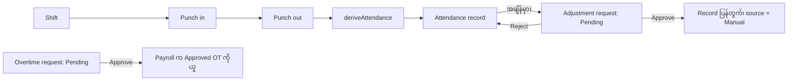

**နေ့စဉ်တွက်ချက်ပုံ ([attendance-calc.ts](../ui/src/app/core/utilities/attendance-calc.ts)):**

| ကိစ္စ | ပုံသေနည်း |
|---|---|
| Late | `checkIn > start + grace` ဖြစ်မှ late ။ late minutes = `checkIn − start` (grace အတွင်းဆို **၀**) |
| Worked | `(checkOut − checkIn) − break` |
| Half day | break နုတ်ပြီး ၂၄၀ မိနစ် (၄ နာရီ) အောက်ဆို |
| Early leave | `end − checkOut` (half day ဆို ၀) |
| Overtime (အလိုအလျောက်) | shift ကုန်ပြီးနောက် ၃၀ မိနစ်ထက်ကျော်မှ၊ ကျော်သမျှ မိနစ်အားလုံး |
| Night shift | ကုန်ချိန်နှင့် check-out ကို သန်းခေါင်ကျော်ပြီး နောက်တစ်နေ့ဟု ယူသည် |

**Punch rules:** record မရှိရင် ဖန်တီးသည်၊ On Leave နေ့ဆို တားမြစ်သည်၊ check-in/out နှစ်ခါ မရ၊ check-out မတိုင်မီ check-in လို၊ day shift မှာ check-out သည် check-in နောက်ကျရမည်။ Weekend/Holiday မှာ punch လုပ်ရင် "Present" ဟု မှတ်ပြီး remark ထည့်သည် (overtime မဖန်တီးပါ)။

**Adjustment:** အနာဂတ်ရက် မရ၊ ထိုရက်အတွက် record ရှိပြီးသား ဖြစ်ရမည်၊ အနည်းဆုံး ပြောင်းစရာ ၁ ခုလို၊ တစ်ယောက်တစ်ရက်လျှင် Pending တစ်ခုသာ။ Approve လုပ်ရင် `deriveAttendance` ကို requested status အတင်းသတ်မှတ်ပြီး ပြန်တွက်သည်။

**Overtime request:** အနည်းဆုံး ၁၅ မိနစ်၊ အများဆုံး ၁၂ နာရီ၊ အနာဂတ်ရက်မရ၊ **တစ်ယောက်တစ်ရက်လျှင် တစ်ခုသာ (status မခွဲ)**။

| Feature | Status |
|---|---|
| Check-in/out, နာရီတွက်ချက်မှု, late, early, half day, night shift | **[I]** |
| Break | **[P]**: shift အလိုက် ပုံသေနုတ်သည်၊ break punch မရှိ |
| Roster | **[P]**: shift + holiday + approved leave ကနေ တွက်ပြသည့် view သက်သက် |
| နေ့စဉ် record / Absent ကို အလိုအလျောက်ဖန်တီး | **[?]**: scheduler မတွေ့ပါ |
| Attendance ကာလ lock / approval | **[N]** |

### ဃ။ Leave Management

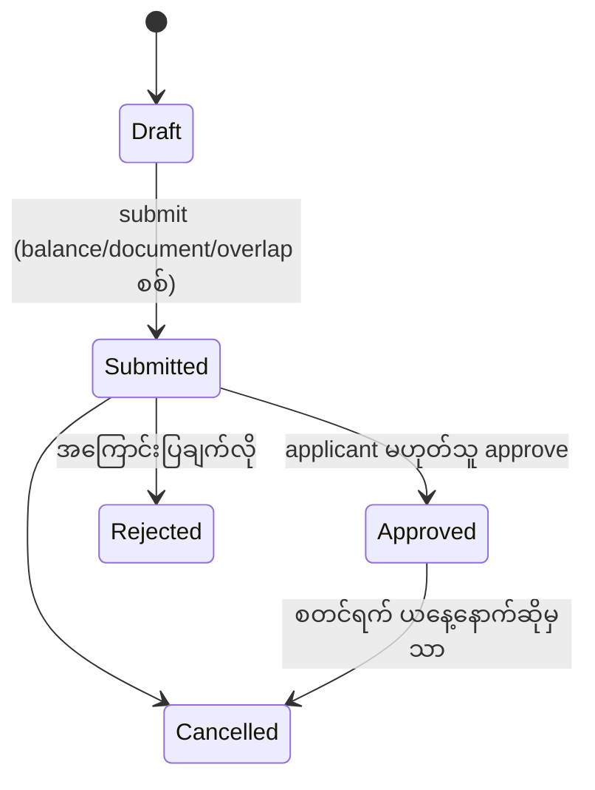

**Entitlement ရှာပုံ ([leave-balance.ts](../ui/src/app/core/utilities/leave-balance.ts)):**

1. Leave type တူပြီး employee ရဲ့ grade နှင့် employment type နှင့် ကိုက်တဲ့ Active policy များကို ရွေးသည် (null ဆိုရင် အားလုံးနဲ့ကိုက်)။
2. `minServiceMonths` မပြည့်သေးသူတွေကို ဖယ်သည်။ ပိုတိကျသူက အနိုင်ရသည် (grade ကိုက် = ၂ မှတ်၊ type ကိုက် = ၁ မှတ်)။
3. Policy လုံးဝမရှိရင် type ရဲ့ default ရက်ကို သုံးသည်။ Policy ရှိပေမဲ့ အားလုံး မပြည့်မီရင် **၀ ရက်**။
4. Monthly accrual ဆိုရင် `ရက် × လက်ရှိလ / ၁၂` (၀.၅ ရက်အဆင့်ဖြင့် ပတ်သည်)။

**Balance:** `available = max(0, entitled − Approved − Submitted)`။ Submit လုပ်ထားသော ရက်တွေကိုလည်း ကြိုဖယ်ထားသည်။

**Application rules:** ရက်ပေါင်း = ပိတ်ရက်နှင့် holiday မပါသော အလုပ်ရက်၊ half day ဆို ၀.၅ (ရက်တစ်ရက်တည်းဖြစ်ရမည်)၊ အလုပ်ရက် အနည်းဆုံး ၁ ရက်ပါရမည်၊ ဝင်ရောက်ရက်မတိုင်မီ မရ၊ type ရဲ့ `maxConsecutiveDays` မကျော်ရ၊ ကျား/မ ကန့်သတ်ချက် (Maternity = မ၊ Paternity = ကျား)၊ Submitted/Approved ခွင့်နှင့် မထပ်ရ။ Submit လုပ်တဲ့အခါ document လိုရင် ပါရမည်၊ ရက်ပေါင်း ≤ available ဖြစ်ရမည်။

**Approval:** **စစ်ဆေးတဲ့ authority စည်းမျဉ်း တစ်ခုတည်းမှာ "ကိုယ့်ခွင့်ကို ကိုယ်တိုင် decide မလုပ်ရ"** ဆိုတာပဲ ဖြစ်သည်။ Reject လုပ်ရင် အကြောင်းပြချက်လို။

**ခွင့်က Attendance ကို သက်ရောက်ပုံ:** Approve ဖြစ်တဲ့အခါ ထိုလူရဲ့ ယနေ့အထိရှိပြီးသား attendance record (Present/Late/Absent/Half Day) တွေကို **On Leave** သို့ ပြောင်းပြီး အချိန်များကို ဖျက်ကာ remark မှာ ခွင့်နံပါတ်ထည့်သည်။ Weekend/Holiday ကို မထိ၊ အနာဂတ်ရက်တွေက record မရှိသေးတာမို့ မထိ။

| Feature | Status |
|---|---|
| Leave type, policy, accrual, balance, half day, multi-day, cancel | **[I]** |
| Carry-forward | **[P]**: flag နှင့် field သာရှိပြီး balance တွက်ရာမှာ မသုံး |
| Encashment | **[N]** |
| Balance ကို လက်ဖြင့်ချိန်ညှိ | **[N]** |
| Manager အလိုက် / အဆင့်များစွာ approval | **[N]** |

### င။ Payroll Management

**Setup [I]:**

- **Component:** Earning သို့မဟုတ် Deduction၊ နည်းလမ်း Fixed / PercentOfBasic / PercentOfGross၊ code ထပ်မရ၊ တန်ဖိုး > ၀၊ ရာခိုင်နှုန်း ≤ ၁၀၀။
- **Structure:** component အနည်းဆုံး ၁ ခု၊ ထို့အပြင် **Earning အနည်းဆုံး ၁ ခု** ပါရမည်။
- **Assignment:** employee + structure (Active) + basic + effective-from။ Basic သည် **job-grade band အတွင်း** ရှိရမည်၊ effective-from သည် ဝင်ရောက်ရက်နောက်ဖြစ်ရမည်၊ တစ်ယောက်တစ်ရက်တည်းမှာ assignment နှစ်ခု မရ၊ နောက်ဆုံး assignment ကို delete မရ။

**Period:** **ပြက္ခဒိန်လတစ်လ**။ အနာဂတ်လ မရ၊ တစ်လကို တစ်ခုသာ၊ pay date သည် period စတင်ရက်မတိုင်မီ မဖြစ်ရ။

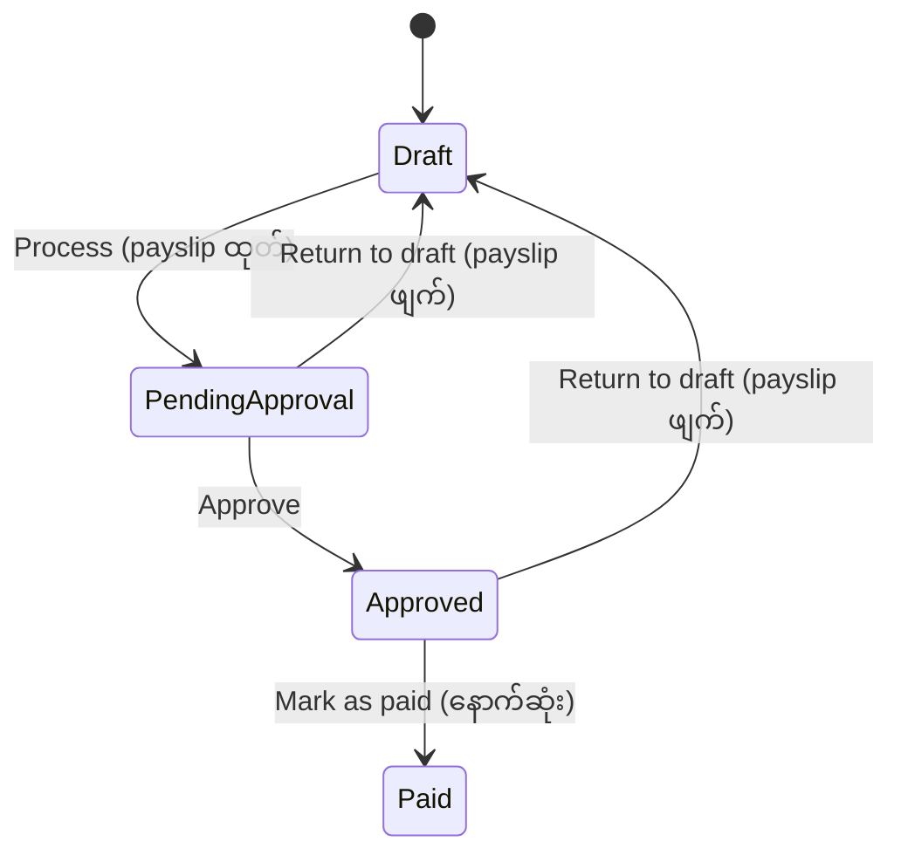

**Process လုပ်ပုံ:**

1. Draft ဖြစ်ရမည်။
2. ယခင်လတစ်လလုံး Draft သို့မဟုတ် Pending Approval ကျန်နေရင် တားသည် (Approved အဆင့်ဆိုရင် မတား)။
3. အလုပ်ရက် = လရက်ပေါင်း − ပိတ်ရက် − holiday။
4. Employee တစ်ယောက်ချင်းစီ - ဝင်ရောက်ရက်က period ကုန်ပြီးနောက်ဆို ကျော်၊ exit date က period မစမီဆို ကျော်။
5. **Period ကုန်ရက်** မှာ အသက်ဝင်နေတဲ့ salary assignment ကို ရှာသည်။ မရှိရင် warning ပေးပြီး ကျော်။
6. Approved unpaid leave ရက်နှင့် Approved overtime မိနစ်များ စုသည်။
7. လစာတွက်ပြီး payslip snapshot ဖန်တီးသည်။ Status ကို Pending Approval သို့ပြောင်းသည်။

**မရှိသေးတာများ:** တကယ့်အခွန်/လူမှုဖူလုံရေး **[N]** (နမူနာ ၅% tax, ၂% social ပဲရှိ)၊ bonus **[N]**၊ သီးသန့် "close" အဆင့် **[N]** (Paid ကပဲ နောက်ဆုံးအဆင့်)၊ bank payment file **[N]**။

---

## ၃။ အစမှအဆုံး Business Flow

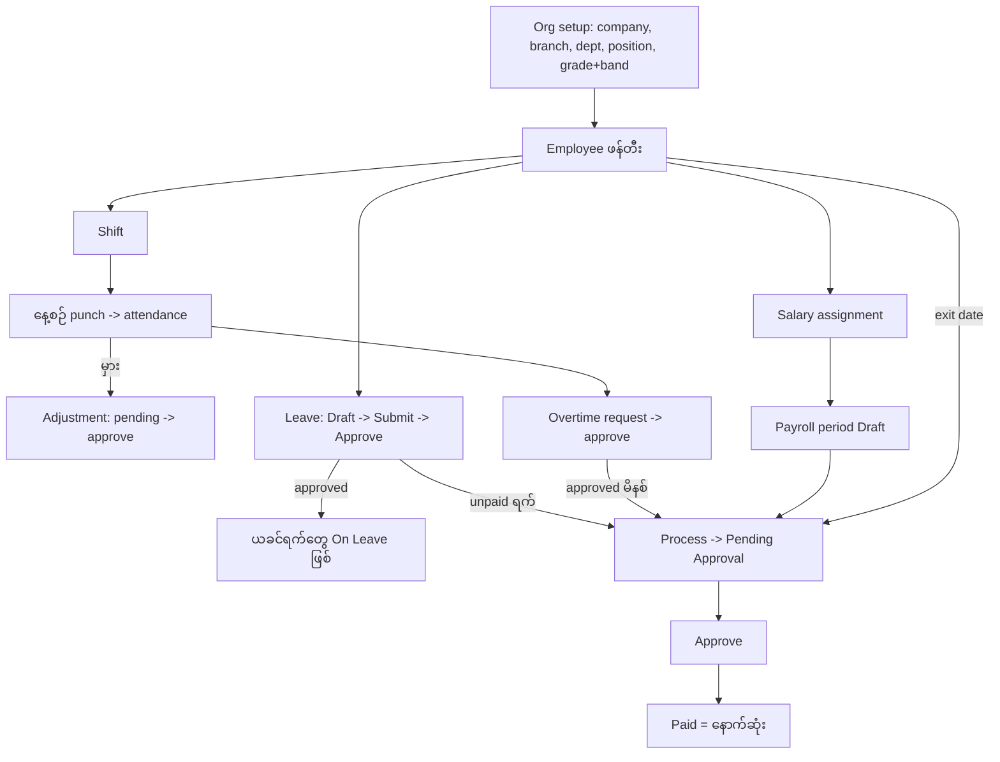

**အရေးကြီးချက်: Attendance record တွေကို payroll က လုံးဝ မဖတ်ပါ။** Payroll ကို သက်ရောက်တာ Leave နှင့် Overtime request တွေသာ ဖြစ်သည်။

---

## ၄။ Module အချင်းချင်း ဆက်စပ်မှု

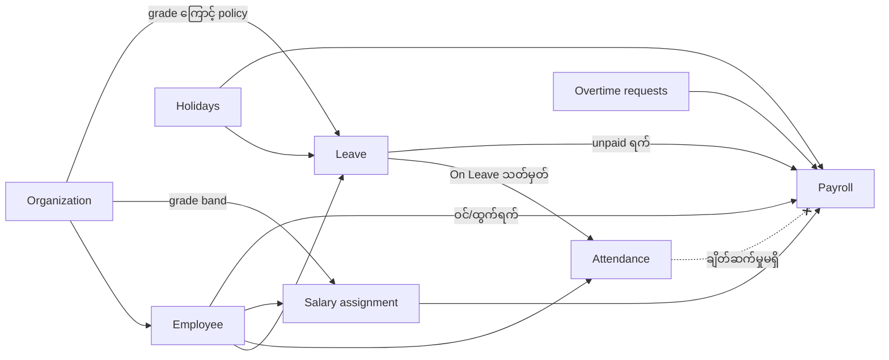

**မေးခွန်း ၁၀ ခုအတွက် အဖြေ:**

| # | မေးခွန်း | အဖြေ |
|---|---|---|
| ၁ | ဝန်ထမ်းအသစ်ဆို တခြား ဘာ record ဖန်တီးလဲ | History တစ်ကြောင်းသာ။ Salary၊ user၊ shift၊ balance မဖန်တီးပါ |
| ၂ | Department ပြောင်းရင် | Chain ကိုက်မကိုက်စစ်ပြီး (position အသစ်လို) "Transfer" history ကျသည်။ Manager၊ shift၊ salary မထိပါ |
| ၃ | Shift ပြောင်းရင် | Roster နှင့် **နောက်ပိုင်း** punch တွေက shift အသစ်သုံးသည်။ ရှိပြီးသား record တွေ ပြန်မတွက်ပါ |
| ၄ | ခွင့် approve ဖြစ်ရင် attendance | ယနေ့အထိ ရှိပြီးသား ရက်တွေ On Leave ဖြစ်သည် |
| ၅ | Unpaid leave → payroll | "Unpaid leave" deduction line ထည့်သည် |
| ၆ | Overtime approve → payroll | "Overtime pay" earning line ထည့်သည် (၁.၅ ဆ) |
| ၇ | နုတ်ထွက်ရင် | Payroll proration သာ တုံ့ပြန်သည် |
| ၈ | Branch ပြောင်းရင် | Manager ကို အလိုအလျောက် မပြောင်း။ နောက်ပိုင်း payslip မှာ နာမည်အသစ်ပေါ်သည် |
| ၉ | Payroll ပြီးမှ attendance ပြင်ရင် | Lock မရှိ၊ payroll က attendance ကို မဖတ်တာမို့ သက်ရောက်မှုမရှိ |
| ၁၀ | Period close (Paid) ဖြစ်ရင် | Status နှင့် `paidOn` ပြောင်းသည်သာ။ နောက်ထပ်ပြင်လို့မရ |

**ပြဿနာအလားအလာ:** Process လုပ်ပြီးမှ ခွင့်/overtime ကို approve လုပ်ရင် payslip က အဟောင်းအတိုင်း ကျန်နေမည်။ Return to Draft လုပ်ပြီး ပြန် process လုပ်မှ ပြင်ဆင်နိုင်သည်။ Paid ဖြစ်သွားရင် ပြင်ဆင်ရန် နည်းလမ်း (arrears) မရှိ။

---

## ၅။ Role နှင့် Approval

**ဖြစ်ရပ်မှန်: Role တွေက data အဖြစ်ရှိပေမယ့် ဘယ်နေရာမှာမှ ပြဋ္ဌာန်းမထားပါ။** Route guard (unsaved-changes guard မှလွဲ၍) မရှိ၊ `hasPermission` ကဲ့သို့ စစ်ဆေးမှုကို grep ဖြင့် မတွေ့ပါ။

| Role | ရည်ရွယ်ချက် (မတားဆီးပါ) |
|---|---|
| HR Administrator | အားလုံး |
| HR Officer | Employee ဖန်တီး/ပြင်၊ attendance/leave approve၊ payroll ကြည့်ရုံ |
| Department Manager | Attendance/leave approve |
| Payroll Officer | Payroll create/edit/approve |
| Recruiter | Recruitment သာ |
| Employee | Self-service ကြည့်ရုံ၊ leave ဖန်တီး |

**Settings မှာ တကယ်ပြဋ္ဌာန်းထားတာ:** built-in role ကို နာမည်ပြောင်း/ဖျက်/deactivate မရ၊ active user ရှိတဲ့ role ကို deactivate မရ၊ HR Administrator ရဲ့ permission ကို မပြင်ရ၊ View မပါဘဲ တခြား action မပေးရ၊ user တစ်ယောက်ကို employee တစ်ယောက်နဲ့သာ ချိတ်ရ၊ ကိုယ့် role ကိုယ်ပြောင်း/ပိတ်မရ၊ active administrator အနည်းဆုံး ၁ ယောက်ရှိရမည်။

**Approval workflow များ:**

| လုပ်ငန်း | ဘယ်သူ approve လုပ်နိုင်လဲ | အဆင့် |
|---|---|---|
| Leave | applicant မှလွဲ၍ ဘယ်သူမဆို | ၁ ဆင့် |
| Attendance adjustment | ဘယ်သူမဆို (တောင်းဆိုသူကိုယ်တိုင်ပါ) | ၁ ဆင့် |
| Overtime | ဘယ်သူမဆို (တောင်းဆိုသူကိုယ်တိုင်ပါ) | ၁ ဆင့် |
| Payroll | Process/Approve/Mark paid ကို လူတစ်ယောက်တည်းလုပ်နိုင် | ၁ ဆင့်၊ တာဝန်ခွဲဝေမှုမရှိ |

Department၊ branch၊ reporting manager အပေါ် မူတည်တဲ့ approval **[N]**၊ အဆင့်များစွာ approval **[N]**။

---

## ၆။ Business Rules အဓိကများ

| ID | Module | Rule | နေရာ |
|---|---|---|---|
| E-01~E-08 | Employee | Code/email ထပ်မရ၊ ကိုယ်တိုင် manager မလုပ်ရ၊ အသက် ၁၈+၊ ရက်စွဲ အစီအစဉ်မှန်၊ exit date လို၊ org chain ကိုက်၊ inactive unit မသတ်မှတ်ရ၊ manager ကို delete မရ | employee-mock.service.ts:100-207 |
| E-09 | Employee | Delete ရင် document/history သာ ဖျက်၊ attendance/leave/salary ကျန်ခဲ့ (orphan) **[P]** | employee-mock.service.ts:240 |
| E-12 | Employee | Probation → Active အလိုအလျောက် **[N]** | မတွေ့ |
| O-01~O-05 | Org | Code ထပ်မရ၊ branch/company ကိုက်၊ section/department ကိုက်၊ grade max ≥ min၊ အသုံးပြုနေလျှင် delete မရ | organization-mock.services.ts |
| A-01~A-03 | Attendance | Late/half-day/overtime တွက်ပုံ | attendance-calc.ts |
| A-04~A-05 | Attendance | Punch စည်းမျဉ်း၊ On Leave နေ့ punch မရ | attendance-mock.services.ts:142 |
| A-06~A-08 | Attendance | Adjustment နှင့် overtime စည်းမျဉ်း | attendance-workflow-mock.services.ts |
| A-10 | Attendance | Period lock **[N]** | မတွေ့ |
| L-01~L-09 | Leave | ရက်တွက်၊ max consecutive၊ ကျား/မ၊ မထပ်ရ၊ document၊ balance၊ self-approve မရ၊ စတင်ပြီးသော ခွင့် cancel မရ | leave-mock.services.ts |
| L-10 | Leave | Approve ဖြစ်ရင် attendance ကို On Leave ပြောင်း | leave-mock.services.ts:380 |
| L-12 | Leave | Carry-forward အသုံးချ/encashment **[N]** | မတွေ့ |
| P-01~P-08 | Payroll | လစဉ် period၊ တစ်လကို တစ်ခု၊ state transition၊ ယခင်လ ပြီးမှ၊ basic grade band အတွင်း၊ payslip snapshot | payroll-mock.services.ts |
| P-09 | Payroll | Role အလိုက် / တာဝန်ခွဲ approval **[N]** | မတွေ့ |
| S-01 | Settings | active administrator အနည်းဆုံး ၁ ယောက်၊ ကိုယ့် role/account ကိုယ်မပြောင်းရ | settings-mock.services.ts:164-185 |

---

## ၇။ တွက်ချက်ပုံများ

**Attendance (GEN shift 09:00-18:00, break 60, grace 15):**

| ဖြစ်ရပ် | ရလဒ် |
|---|---|
| ၀၉:၁၀ ဝင်၊ ၁၈:၀၀ ထွက် | 550 ≤ 555 (grace အတွင်း) → **Present**၊ late ၀၊ worked 450 |
| **၀၉:၃၀ ဝင်** | 570 > 555 → **Late ၃၀ မိနစ်** |
| ၁၉:၀၀ ထွက် | ကုန်ချိန်ကျော် ၆၀ မိနစ် > ၃၀ → overtime ၆၀ (သို့သော် request approve မလုပ်ရင် မပေး) |
| ၀၉:၀၀ ဝင်၊ ၁၂:၃၀ ထွက် | 210 − 60 = 150 < 240 → **Half Day** |

**Leave:**

- Standard annual policy (၃ လပြည့်မှ): service ၂ လဆို entitlement **၀**၊ ၃ လဆို ၁၅ ရက်။
- Casual leave (monthly accrual): နိုဝင်ဘာမှာ 6 × 11 / 12 = **5.5 ရက်**။
- Manager (grade 6): annual leave **၁၈ ရက်** (grade policy က default ကို အနိုင်ယူ)။

**Payroll ပုံသေနည်း ([payroll-calc.ts](../ui/src/app/core/utilities/payroll-calc.ts)):**

```
proration   = အလုပ်လုပ်ခဲ့ရက် / period ရက်ပေါင်း        (ဝင်/ထွက်ရက်ပါလျှင်၊ exit ရက်ကိုပါ ထည့်သွင်းတွက်)
basic       = basicSalary × proration
earning     = Fixed: value × proration | % of basic: basic × value / 100
hourly      = basicSalary / (အလုပ်ရက် × 8)              (basic အပြည့်၊ proration မလုပ်)
overtimePay = OT နာရီ × hourly × 1.5
gross       = basic + earnings + overtimePay
deduction   = Fixed: value × proration | % of basic | % of gross
unpaid      = unpaid ရက် × (basicSalary / အလုပ်ရက်)     (basic အပြည့်)
net         = gross − (deductions + unpaid)
```

**ဥပမာ:** basic 3,000၊ အလုပ်ရက် ၂၂၊ housing 10% of basic၊ transport 50၊ tax 5% of gross၊ unpaid ၂ ရက်၊ OT ၂ နာရီ။

- Earnings = 300 + 50 = 350
- Hourly = 3000 / 176 = 17.045 → OT = 2 × 17.045 × 1.5 = **51.14**
- Gross = 3000 + 350 + 51.14 = **3,401.14**
- Tax = 5% × 3,401.14 = 170.06
- Unpaid = 2 × (3000 / 22) = 272.73
- Net = 3,401.14 − 170.06 − 272.73 = **2,958.35**

**သတိထားစရာ ထူးခြားချက်များ:**

- Unpaid leave က **deduction အဖြစ်သာ** နုတ်သည်၊ gross ကို မလျှော့ပါ။ ထို့ကြောင့် % of gross တွက်သော tax က gross အပြည့်ပေါ်မှာ တွက်နေဆဲဖြစ်သည်။
- Overtime နှင့် unpaid leave နှစ်ခုလုံးက basic အပြည့်ကို သုံးပြီး proration မလုပ်ပါ။ Allowance တွေ မပါပါ။
- လအလယ်မှာ လစာတိုးရင် ခွဲမတွက်ပါ။ **လကုန်ရက်မှာ အသက်ဝင်သော assignment** ကို တစ်လလုံးအတွက် သုံးသည်။
- Late နှင့် absent က လစာကို မသက်ရောက်ပါ။ Unpaid leave application သာ သက်ရောက်သည်။

---

## ၈။ လက်တွေ့ ဖြစ်ရပ်များ

**ဖြစ်ရပ် ၂ - ၃၀ မိနစ် နောက်ကျ:** GEN shift၊ ၀၉:၃၀ punch in → Late (၃၀ မိနစ်)၊ remark "Late arrival"။ Approval မလိုပါ။ Overview ရဲ့ late စာရင်းမှာ ပေါ်သည်။ Payroll မထိ။

**ဖြစ်ရပ် ၃ - Annual leave ၃ ရက်:**

1. Draft ဖန်တီး → ရက်ပေါင်းကို ပိတ်ရက်ချန်ပြီး တွက်သည်၊ max consecutive (၁၀)၊ overlap၊ joining date စစ်သည်။
2. Submit → balance စစ်ပြီး ၃ ရက်ကို pending အဖြစ် ကြိုထားသည်။
3. **တခြားသူ** က Approve → pending က taken ဖြစ်ပြီး ယခင်ရက်တွေ On Leave ဖြစ်သည်။ Applicant ကိုယ်တိုင် approve လုပ်ရင် "You cannot decide your own leave request" ဟုပြသည်။

**ဖြစ်ရပ် ၄ - Unpaid leave:** `UL` type ဖြင့် အတူတူပင်။ Approve ပြီးနောက် ထိုလ payroll မှာ "Unpaid leave" deduction ထည့်သည်။ ခွင့်ကို နောက်မှ cancel လုပ်လျှင် ထုတ်ပြီးသား payslip ကို မပြောင်းပါ။

**ဖြစ်ရပ် ၅ - OT ၂ နာရီ:** Overtime request ကို သီးသန့်ဖန်တီး (Pending) → approve → period process လုပ်ချိန်မှာ "Overtime pay" ဖြစ်သည်။ Punch ကနေ အလိုအလျောက်ထွက်လာတဲ့ overtime နှင့် မဆက်စပ်ပါ။ Process ပြီးမှ approve လုပ်ရင် Return to Draft ပြီး ပြန် process လုပ်ရမည်။

**ဖြစ်ရပ် ၆ - Department ပြောင်း:** Department ပြောင်းရုံနှင့်မရ၊ position အသစ်ပါ ရွေးရသည်။ "Transfer" history ကျမည်။ Manager၊ shift၊ salary မပြောင်း။ နောက်ပိုင်း payslip မှာ department အသစ်ပေါ်မည်။

**ဖြစ်ရပ် ၇ - Period အလယ်မှာ နုတ်ထွက်:** Resigned + exit date ၂၀ ရက်နေ့။ "Exit" history ကျသည်။ ထိုလ payroll ကို ၂၀/၃၀ ရက်အတိုင်း prorate လုပ်သည်။ User account၊ စောင့်ဆိုင်းနေသောခွင့်၊ လက်အောက်ငယ်သားများကိုမူ မထိပါ။

---

## ၉။ မရှိ / မပြည့်စုံသော အချက်များ

**မရှိသေး [N] (သက်သေခိုင်လုံ):**

- Recruitment → Employee အလိုအလျောက်ပြောင်းခြင်း။
- Probation အလိုအလျောက်အတည်ပြုခြင်း၊ notice period၊ နုတ်ထွက်ချိန် final settlement၊ clearance။
- Leave encashment၊ carry-forward အသုံးချခြင်း။
- Manager/department အလိုက် approval၊ အဆင့်များစွာ approval၊ role ပြဋ္ဌာန်းခြင်း။
- Division၊ Team။
- တကယ့်အခွန်/လူမှုဖူလုံရေး၊ bonus။
- Attendance lock၊ payroll ပြီးနောက် ပြောင်းလဲမှုကာကွယ်ခြင်း၊ arrears။

**တစ်စိတ်တစ်ပိုင်း / မညီမျှသော အချက်များ:**

- **Employee delete:** document/history သာ ဖျက်ပြီး attendance/leave/salary/payslip တွေ ကျန်ခဲ့သည် (orphan)။
- **Overtime ထပ်မနေရ စည်းမျဉ်း** က status မခွဲပါ။ ထို့ကြောင့် Rejected ဖြစ်ထားသော ရက်အတွက် ပြန်တောင်းလို့မရ။
- **Overtime နှစ်မျိုး:** punch ကထွက်တဲ့ OT ကို ပြသသော်လည်း မပေးပါ။ သီးသန့် approve လုပ်ထားသော request သာ ပေးသည်။
- **Leave balance နှစ်:** submit စစ်ရာမှာ ယခုနှစ်နှင့် ယနေ့ရက်ကိုသာ အမြဲသုံးသည် (တခြားနှစ်ခွင့်အတွက်ပါ)။
- **ခွင့် cancel** လုပ်ရင် On Leave သို့ ပြောင်းထားသော attendance ကို ပြန်မပြင်ပါ။
- **နုတ်ထွက်ပြီးသူ** အတွက်လည်း ခွင့်လျှောက်လို့ရသည် (joining date သာ စစ်သည်)။
- **Payroll** က employment status (Suspended စသည်) ကို မကြည့်ဘဲ ရက်စွဲသာ ကြည့်သည်။
- **Grade ပြောင်းရင်** လက်ရှိ basic က band အတွင်းရှိမရှိ ပြန်မစစ်ပါ။
- **National ID** ထပ်မနေရ စစ်ဆေးမှု မရှိပါ။
- **General Settings** (timezone, currency စသည်) ကို တခြား screen က မဖတ်ပါ။

**အန္တရာယ်များ:** payroll မှာ တာဝန်ခွဲဝေမှု (maker-checker) မရှိ၊ process ပြီးနောက် approve လုပ်ထားသောခွင့်/OT ကြောင့် payslip အဟောင်းကျန်နိုင်၊ Paid ဖြစ်ပြီးနောက် ပြင်ရန်နည်းလမ်းမရှိ၊ reload လုပ်ရင် data ပျောက်၊ audit trail က employee history နှင့် activity feed သာ ရှိသည်။

---

## ၁၀။ နိဂုံးချုပ်

1. **Setup:** Organization (company → branch → department → section → position) နှင့် grade band၊ leave type/policy၊ shift၊ holiday၊ salary component/structure ကို ပြင်ဆင်သည်။
2. **ခန့်အပ်:** Recruitment က လူရွေးသော်လည်း employee ဖန်တီးခြင်းက **လက်နှင့်သီးသန့်လုပ်ရသည့် အဆင့်**။ Probation ဖြင့် ဖန်တီးပြီး salary နှင့် shift ကို သီးခြားသတ်မှတ်ရသည်။ Salary က grade band ထဲရှိရမည်။
3. **အလုပ်လုပ်:** နေ့စဉ် punch ကနေ shift စည်းမျဉ်းအရ attendance ဖြစ်ပေါ်သည်။ အမှားများကို approved adjustment ဖြင့်ပြင်သည်။ အပိုနာရီကို သီးသန့် approve လုပ်ထားသော overtime request ဖြင့်သာ ပေးသည်။
4. **ခွင့်:** Policy နှင့် grade ကနေ entitlement ရသည်။ Applicant မဟုတ်သူက approve လုပ်သည်။ Approve လုပ်ရင် ယခင် attendance ကို On Leave ပြောင်းသည်။
5. **လစာ:** လစဉ် period ဖန်တီးပြီး process လုပ်သည်။ Salary၊ structure၊ ဝင်/ထွက်ရက်၊ unpaid leave၊ overtime၊ holiday တို့ကိုယူပြီး payslip snapshot ထုတ်သည်။ Approve → Paid (နောက်ဆုံး)။
6. **ထွက်ခွာ:** Resigned/Terminated + exit date ထည့်ရင် "Exit" history ကျသည်။ အလိုအလျောက် ဖြစ်တာက payroll proration တစ်ခုတည်း။ Settlement၊ ခွင့်ငွေပေးချေမှု၊ ရှင်းလင်းမှု လုပ်ငန်းစဉ်များ မရှိပါ။

**မှတ်ထားရမည့် အဓိကအချက် ၃ ခု:**

- စနစ်ရဲ့ တကယ့်ချိတ်ဆက်မှုများမှာ **Leave → Attendance**၊ **Leave/Overtime → Payroll**၊ **Org → Employee/Salary/Leave policy** တို့ဖြစ်သည်။
- Attendance က သီးခြား record ဖြစ်ပြီး လစာတွက်ရာတွင် input မဟုတ်ပါ။
- Role နှင့် approval authority တို့ကို လက်ရှိ ဘယ်နေရာမှာမှ ပြဋ္ဌာန်းမထားပါ။
